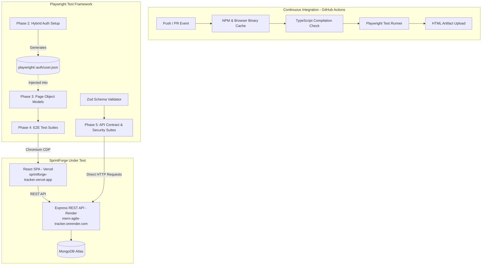

# SprintForge Automation Suite

> Production-grade End-to-End (E2E) and REST API Contract Test Automation Framework for **SprintForge**, an agile sprint tracking and Kanban management platform.

[](https://github.com/UnknownArk/sprintforge-automation-suite/actions/workflows/test.yml)
[](https://nodejs.org/)
[](https://playwright.dev/)
[](https://www.typescriptlang.org/)
[](https://zod.dev/)

---

## 1. System Architecture



---

## 2. Framework Highlights

- **Fast Hybrid Authentication**: Bypasses slow repetitive browser UI login sequences across the test suite by executing an API-level authentication request and seeding browser `localStorage` (`token` and `user`), serialized to a reusable `storageState`. Includes an automated Page Object Model-driven UI fallback.
- **Semantic Page Object Models (POM)**: Fully encapsulates UI locators and actions using user-facing semantic queries (`getByRole`, `getByPlaceholder`, input types) adhering strictly to the Page Object pattern.
- **Strict Schema Contract Enforcement**: Implements runtime Zod schema parsing (`TaskSchema`, `ProjectSchema`, `ApiErrorSchema`) against live REST responses, catching API drift, missing attributes, and type violations immediately.
- **Security & Authorization Boundaries**: Verifies endpoint protection by asserting HTTP `401 Unauthorized` responses against unauthenticated requests across all HTTP verbs (`GET`, `POST`, `PUT`, `DELETE`), forged JWT signatures, and malformed authorization headers.
- **Robust Deterministic Execution**: Uses isolated test run identifiers and event-driven network hydration for CRUD state transitions to guarantee zero test flakiness under parallel execution.

---

## 3. Directory Layout

```
sprintforge-automation-suite/
├── .github/
│   └── workflows/
│       └── test.yml                 # GitHub Actions CI workflow (caching, headless, reporting)
├── pages/
│   ├── BasePage.ts                 # Base POM with navigation and core abstractions
│   ├── LoginPage.ts                # Login view POM (email, password, auth errors)
│   └── BoardPage.ts                # Kanban board POM (workspace, tasks, modal, filters)
├── playwright/
│   └── .auth/                      # Ignored storageState session artifacts
├── schemas/
│   └── task.schema.ts              # Zod schemas for Tasks, Projects, and Error payloads
├── tests/
│   ├── setup/
│   │   └── auth.setup.ts           # Hybrid authentication and session state seeding
│   ├── e2e/
│   │   ├── auth.spec.ts            # UI authentication, validation, and redirect suite
│   │   └── board-crud.spec.ts      # Project and task lifecycle E2E suite
│   └── api/
│       └── tasks-contract.spec.ts  # REST contract validation and 401 boundary suite
├── .env.example                    # Environment variable template
├── playwright.config.ts            # Playwright runner configuration
├── package.json                    # Dependencies, test scripts, and metadata
└── tsconfig.json                   # Strict TypeScript compiler configuration
```

---

## 4. Defects Discovered & Root Cause Analysis (RCA)

During the construction and execution of this automation suite against the live SprintForge deployment, several real-world defects and architectural nuances were uncovered:

### Defect 1: Form Label Accessibility Disconnect (WCAG 2.1 AA Failure)
* **Severity**: `Medium` (Accessibility Violation & Automation Friction)
* **Observation**: Playwright's accessible locator `page.getByLabel('Email')` failed to find the input despite visible "Email" and "Password" label elements.
* **Root Cause**: The React login form renders `<label>Email</label>` and `<input type="email" />` as adjacent siblings without linking `htmlFor` on the label to an `id` on the input, and without wrapping the input inside the `<label>` tag.
* **Engineering Impact**: Screen readers and assistive technology cannot associate the label text with the input field, hindering visually impaired users.
* **Framework Workaround**: Refactored `LoginPage.ts` to locate controls via `input[type="email"]` and `input[type="password"]`.
* **Recommended Product Fix**:
  ```tsx
  // Current:
  <label>Email</label>
  <input type="email" value={email} onChange={...} />

  // Corrected:
  <label htmlFor="login-email">Email</label>
  <input id="login-email" type="email" value={email} onChange={...} />
  ```

---

### Defect 2: Missing Root Resource Index (`GET /api/tasks` returns 404)
* **Severity**: `Low` (REST Convention Inconsistency)
* **Observation**: Calling `GET /api/tasks` directly yields an HTTP `404 Not Found`.
* **Root Cause**: The backend router does not expose a global task collection endpoint. Tasks are strictly queryable through the nested route `GET /api/tasks/project/:projectId`.
* **Engineering Impact**: API consumers attempting standard RESTful resource enumeration will encounter unexpected 404s.
* **Framework Workaround**: The API test harness creates a scoped fixture project and targets `GET /api/tasks/project/:projectId` for contract validation.

---

### Defect 3: Async Workspace Hydration Delay on Cold Starts
* **Severity**: `Low` (UI Loading State Defect)
* **Observation**: In rapid test executions, project listing checks occasionally encountered zero items before populating half a second later.
* **Root Cause**: The React sidebar fires `fetch('/api/projects')` inside `useEffect` without displaying an intermediate loading skeleton or disabled placeholder while awaiting the Render backend's response.
* **Framework Workaround**: `BoardPage.goto` registers event-driven `waitForResponse` for `/api/projects` to ensure deterministic DOM hydration prior to executing assertions.
* **Recommended Product Fix**: Implement a loading state or skeleton loader in the sidebar during project fetch.

---

### Defect 4: Unlinked Status and Priority Dropdown Labels in Task Modal
* **Severity**: `Medium` (Accessibility Violation)
* **Observation**: In the task modal, `<label>Status</label>` and `<label>Priority</label>` are disconnected from their underlying `<select>` elements, causing `getByLabel('Status')` to resolve to null.
* **Root Cause**: Missing `htmlFor` / `id` pairings in the modal's `.form-group` markup.
* **Engineering Impact**: Form fields fail programmatic label association under WCAG 2.1 AA criteria.
* **Framework Workaround**: Located selects using container-scoped `.form-group` traversal.

---

## 5. Local Setup & Execution

### Prerequisites
- Node.js `>= 20.0.0`
- npm `>= 10.0.0`

### 1. Clone & Install
```bash
git clone https://github.com/UnknownArk/sprintforge-automation-suite.git
cd sprintforge-automation-suite
npm install
```

### 2. Configure Environment
Create a `.env` file from the provided example:
```bash
cp .env.example .env
```

| Variable | Description | Default Value |
|---|---|---|
| `BASE_URL` | SprintForge Frontend URL | `https://sprintforge-tracker.vercel.app` |
| `API_BASE_URL` | SprintForge Backend API URL | `https://mern-agile-tracker.onrender.com` |
| `TEST_USER_EMAIL` | Test Account Username / Email | `automation_runner@test.com` |
| `TEST_USER_PASSWORD` | Test Account Secret | `TestSecret123!` |

### 3. Run Tests

```bash
# Execute the entire test suite (Setup + E2E + API)
npm test

# Run UI E2E tests only
npm run test:e2e

# Run REST API contract & security tests only
npm run test:api

# Run tests in headed browser mode
npm run test:headed

# Launch interactive Playwright UI mode
npm run test:ui

# View latest HTML test report
npm run report
```

### 4. Static Analysis & Type Checking
```bash
npx tsc --noEmit
```

---

## 6. CI/CD Integration

The test suite is automated via GitHub Actions in [`.github/workflows/test.yml`](.github/workflows/test.yml):
- **Triggers**: On every `push` and `pull_request` targeting `main`, or via manual `workflow_dispatch`.
- **Optimization**: Playwright browser binaries and npm dependencies are cached, reducing build times.
- **Reporting**: Full Playwright HTML reports and failure traces/videos are archived as artifacts on every run.
